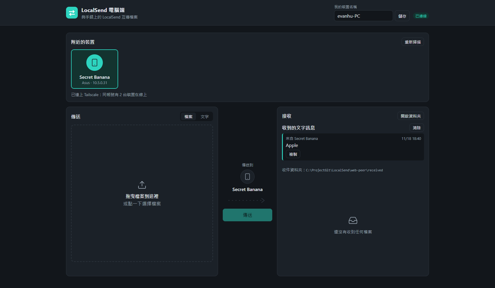
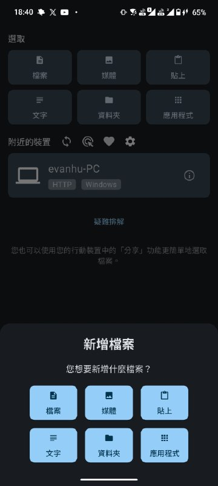
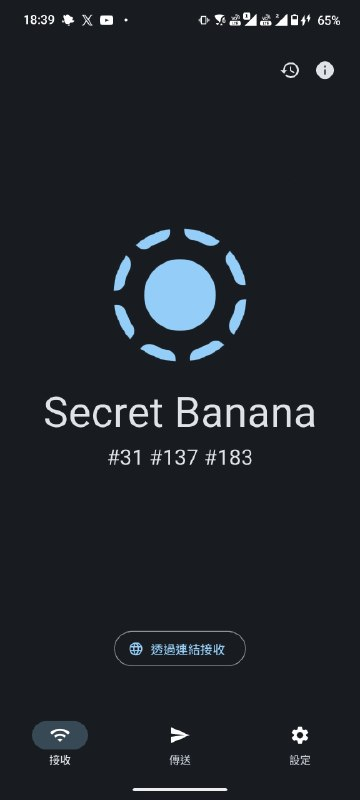

# LocalSend 多平台通用版

在區域網路裡互傳檔案與文字。手錶、手機、平板用同一支 App，電腦打開瀏覽器就能收發，不必再裝一套桌面程式。

這是 [LocalSend](https://github.com/localsend/localsend) 的個人修改版，協定與官方版相容。官方基底是 **1.18.2**（官方 `main` 的 `2e7ef197`，2026-11-11）。

本倉庫只供個人使用，不會送回 LocalSend 官方（官方不接受 AI 產生的程式碼貢獻）。



網頁版寬螢幕。上方選一台附近的裝置，中間把檔案或文字送出去，右側收下對方傳來的檔案與文字。

## 手機版

同一支 Android App 在一般手機上維持官方版面。下面是實機畫面：左邊在傳送頁選檔，並看到電腦；右邊在接收頁等對方傳來的檔案。

| 傳送 | 接收 |
|---|---|
|  |  |

## 一套程式，多種裝置

| 裝置 | 怎麼用 | 本倉庫的情況 |
|---|---|---|
| Android 手錶 | 安裝本倉庫編出的 App。小螢幕會自動換成手錶版面 | 已在實機編譯、安裝，傳檔測試通過 |
| Android 手機、平板 | 同一支 App。一般螢幕維持官方版面 | 手機尺寸截圖與官方逐像素比對無差異 |
| Windows、macOS 電腦 | [web-peer/](web-peer/)：雙擊啟動，用瀏覽器操作 | 已和手錶互傳文字；也和官方 Rust CLI 雙向互通，SHA-256 相符 |
| iOS、Linux、Windows / macOS 桌面版、官方 CLI | 安裝官方程式即可，協定完全相容 | 這些目標沒有修改，也沒有重新編譯或測試 |

不在同一個 Wi-Fi 時，電腦和手錶可以登入同一個 [Tailscale](https://tailscale.com/) 帳號再傳。做法寫在 [web-peer/README.md](web-peer/README.md)。

## 快速開始

### 電腦：啟動網頁版

1. 安裝 [Node.js](https://nodejs.org/) 18 以上。
2. Windows 雙擊 [web-peer/start.bat](web-peer/start.bat)，Mac 雙擊 [web-peer/start.command](web-peer/start.command)。第一次會自動安裝套件，並打開 `http://127.0.0.1:53318`。
3. Windows 防火牆跳出提示時，若 Wi-Fi 是公用網路，要勾選「公用網路」。也可以把 Wi-Fi 改成私人網路。
4. 手錶和電腦連同一個 Wi-Fi，打開手錶上的 LocalSend。雙方會出現在彼此的「附近的裝置」。

防火牆、Tailscale、收件資料夾與疑難排解見 [web-peer/README.md](web-peer/README.md)。協定規格見 [web-peer/PROTOCOL.md](web-peer/PROTOCOL.md)。

電腦端也可以直接安裝官方 LocalSend 桌面版，協定相容。

### 手錶：安裝 App

1. 依照下方「[編譯手錶 APK](#編譯手錶-apk)」產生 `app-release.apk`。
2. 在電腦上開一個下載服務，讓手錶取得 APK：

   ```bash
   cd app/build/app/outputs/flutter-apk
   python -m http.server 8765
   ```

3. 手錶瀏覽器打開 `http://<電腦IP>:8765/app-release.apk`，或把網址做成 QR 碼讓手錶掃描。
4. 在瀏覽器的「下載」清單點開 APK，允許「安裝未知來源的應用程式」。

## 和官方版的差異

### 手錶小螢幕

縮小與精簡只在小螢幕生效。判斷條件是 `SizingInformation.isCompactScreen(context)`：短邊 < 360dp，而且長邊 < 480dp。一般手機的長邊大約至少 480dp，所以不受影響。

| 畫面 | 官方版在手錶上 | 修改後 |
|---|---|---|
| 傳送等待頁 | 內容溢出，狀態文字和「驗證」按鈕重疊 | 上半部可以捲動，「取消」固定在底部 |
| 新增檔案面板 | 只看得到第一排按鈕 | 面板可用整個螢幕高度，6 個選項都能點 |
| 進度頁 | 底部卡片佔掉大半螢幕，檔名被截到約 10 個字 | 卡片縮小，檔名可換行 |
| QR 碼對話框 | 固定 200×200，網址和「關閉」重疊 | QR 依寬度縮放，內容可以捲動 |
| 說明對話框 | 文字被截斷 | 內容可以捲動 |
| 連結分享頁 | 網址列太寬，最後一個按鈕被裁掉 | 網址換行，三個按鈕都完整 |
| 裝置名稱 | 名稱太長時字被縮到幾乎看不見 | 改成用「…」截斷 |
| 底部導覽列 | 高 80dp，內容只剩約 320dp | 改成 56dp，只顯示選中項的文字 |

### 網頁版電腦端

- 用 Node.js 實作 LocalSend v2：HTTPS 雙向憑證、連接埠 53317、多播探索。手錶 App 不必改設定。
- 網頁介面只綁在 `127.0.0.1:53318`。區網裡的其他裝置看不到這個網頁，也會擋下其他網站從瀏覽器發出的請求。
- 收到的檔案存在 `web-peer/received/`。同名不覆蓋，傳輸中斷不留殘檔。
- 相依套件只有 `node-forge`（產生自簽憑證）。

### 斷點續傳

傳到一半斷線時，從接收端已收到的位置接著傳。這是本倉庫自己加的協定擴充，官方版沒有。

- **自動重連**：Wi-Fi 斷一下、換基地台、傳送端 IP 改變時，傳送端會自動重連。大約 5 分鐘沒有進展才放棄。進度頁顯示「重新連線中…」。
- **跨傳輸續傳**：App 被關掉、手機重開，或任一方按了取消之後，把同一個檔案再傳給同一台，會從上次的位置接著傳。確認畫面會顯示「將從 X% 接續」。
- 續傳完成的檔案會比對整檔 SHA-256。不符就從頭重傳。沒傳完的檔案用隱藏的暫存檔名存放，7 天沒有接續就自動刪除。
- 規格見 [docs/resume-protocol.md](docs/resume-protocol.md)。

### 其他

- 已移除 `.github/dependabot.yml`。本倉庫只在 `main` 開發。
- `app/android/gradle.properties` 加入 Flutter 遷移工具產生的兩行相容設定：`android.builtInKotlin=false`、`android.newDsl=false`。
- GitHub Actions 沿用官方工作流程，沒有針對本倉庫調整，不保證能跑。

## 實測裝置

| 項目 | 數值 |
|---|---|
| 手錶 | XG_Watch（紫光展銳 W527，小糯米系統） |
| 系統 | Android 9（API 28），沒有 Google 服務 |
| 螢幕 | 408×502 px、200 dpi，換算 326×400 dp |
| CPU 架構 | arm64-v8a、armeabi-v7a |
| 電腦 | Windows 11，Node.js v26 |

## 編譯手錶 APK

### 需要的工具

| 工具 | 版本 |
|---|---|
| Flutter | 3.47.9（本機裝在 `C:\flutter`，沒有使用 fvm） |
| Rust | 1.97.1，另加 `aarch64-linux-android`、`armv7-linux-androideabi`、`x86_64-linux-android` |
| Android SDK | 含 NDK。建置時 Gradle 會自動下載需要的版本 |
| Java | 17 |
| Visual Studio | C++ 編譯工具（Rust 在 Windows 上需要） |

LocalSend 的網路功能是 Rust 寫的，所以編 Android 版一定要裝 Rust。

### 簽名設定（只需要做一次）

建立 `app/android/key.properties`（已被 `.gitignore` 排除），指向 Android 的 debug 金鑰：

```properties
storeFile=C:/Users/<使用者>/.android/debug.keystore
storePassword=android
keyAlias=androiddebugkey
keyPassword=android
```

沒有這個檔案，release 版會產生無法安裝的未簽名 APK。

### 編譯步驟（Git Bash）

```bash
export PATH="/c/flutter/bin:$HOME/.cargo/bin:$PATH"
export ANDROID_HOME="C:/Users/<使用者>/AppData/Local/Android/Sdk"
cd app
flutter pub get
dart run build_runner build -d
dart run slang
# 不開 Windows「開發人員模式」也能編：編譯期間暫時把桌面版資料夾改名
mv windows _windows_off && mv linux _linux_off
flutter build apk --release --no-pub --android-skip-build-dependency-validation --target-platform android-arm,android-arm64
mv _windows_off windows && mv _linux_off linux
```

產出：`app/build/app/outputs/flutter-apk/app-release.apk`（約 80MB）。第一次要編 Rust，大約需要 15 到 20 分鐘。

兩個特殊處理的原因：

- **桌面版資料夾改名**：Flutter 在 Windows 上處理外掛時要建立符號連結，必須開「開發人員模式」。只編 Android 版用不到 `windows/`、`linux/`，暫時改名就能避開。編譯中途失敗的話，記得把名稱改回來。
- **`--android-skip-build-dependency-validation`**：專案的 Gradle 是 8.13，Flutter 要求至少 8.14。這個差距不影響實際建置，所以跳過檢查。

## 測試

### 手錶 App 版面

[app/test/watch/](app/test/watch/) 會把 82 個畫面情境渲染成手錶與手機兩種尺寸的截圖，並檢查內容溢出：

```bash
cd app
# 手錶尺寸（326×400），有任何溢出就判定失敗
/c/flutter/bin/flutter test --no-pub test/watch/watch_screens_test.dart --dart-define=WATCH_STRICT=true
# 手機尺寸（412×915），和 test/watch/goldens_phone/ 的截圖比對
/c/flutter/bin/flutter test --no-pub test/watch/watch_screens_test.dart --dart-define=WATCH_SIZE=phone
# 全部測試
/c/flutter/bin/flutter test --no-pub
```

修改版面後要更新截圖，加上 `--update-goldens`。

### 網頁版電腦端

沒有自動化測試腳本。互通測試是手動用本倉庫 [cli/](cli/) 編出的官方 Rust `localsend-cli` 和 web-peer 互傳，再比對 SHA-256：

```bash
# 1. 編譯官方 CLI
cd cli && cargo build
# 2. 啟動 web-peer（另一個視窗）：web-peer\start.bat
# 3. CLI 傳檔給 web-peer（CLI 改用 53320 埠，避開 web-peer 佔用的 53317）
LOCALSEND_PORT=53320 ../target/debug/localsend-cli send --to <電腦IP> <檔案>
# 4. 在網頁上按「接受」，再比對兩邊檔案的 SHA-256
```

反方向（web-peer 傳給 CLI）時，CLI 的接收端是互動模式，要在主控台按 Y 接受。

## 同步官方新版

```bash
git fetch upstream          # upstream 只追蹤官方的 main
git merge upstream/main     # 直接合併進 main，不開分支
```

合併後：

1. 如果官方又加回 `.github/dependabot.yml`，把它刪掉。
2. 重跑上面的手錶版面測試與全部測試。
3. 重新編譯 APK，在手錶上實測一次。

## 已知限制

- 進度頁的浮動狀態卡會蓋住最後一個檔案的狀態，往上捲就看得到。
- 「本機網路權限」面板空間較小，內容要在面板內捲動。這個面板在 Android 9 上不會出現。
- APK 用 debug 金鑰簽名，和官方版簽名不同，不能直接覆蓋安裝官方版。
- 網頁版只在單一台電腦和單一個 Wi-Fi 環境測過。有些路由器或手機熱點會擋多播，這時要用網頁上的「重新掃描」逐一詢問網段。
- 手機熱點如果會隔離連線裝置，電腦和手錶之間就無法互傳。手機和手錶之間不受影響。
- 斷點續傳只在兩邊都是本倉庫的 App、開著加密、而且傳送端開著「計算檢查碼」時有效。和官方版、網頁版互傳時照舊整檔傳送。
- 接收端換了 IP 時，自動重連會在約 5 分鐘後放棄。重新傳送同一個檔案即可從斷點接續。

## 授權

本倉庫沿用 LocalSend 的 [Apache License 2.0](LICENSE)。原作者與貢獻者為 LocalSend 團隊，官方專案位於 <https://github.com/localsend/localsend>。本倉庫的修改內容列在上方「和官方版的差異」。
